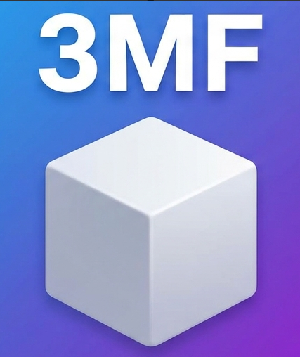

<p align="center"></p>

# 3MF Fixer for 3D Builder

Makes 3MF files saved by slicers such as Bambu Studio open in Microsoft 3D Builder again.

**Your file stays on your device: everything runs in the browser.**

**➡ Open the tool: https://covrig.github.io/3mf-fixer/**

## The problem

After a 3MF file is opened and saved in Bambu Studio (or a slicer based on it, such as OrcaSlicer),
Microsoft 3D Builder refuses it:

> Couldn't load that. Error code: 0x80004005

These slicers store each object's mesh in a separate file inside the 3MF package and link to it from the
main model (`<component p:path="/3D/Objects/object_1.model" …>`, from the 3MF Production extension).
3D Builder can't follow those links. The slicers also drop the colours that were set in 3D Builder.

## What the fix does

- Merges all linked meshes into a single `3D/3dmodel.model`. Every part keeps its shape, position and name.
- Keeps the colours stored in the file, including the slicer's filament colours and painted areas
  (each painted triangle gets the colour covering most of it).
- If the colours were lost, you choose: a different colour per part (**Fix · Multicolour**) or one colour
  for everything (**Fix · One colour**).
- Removes slicer settings, plates and slicer thumbnails, and stores a small preview picture instead.
  The fixed file is usually smaller than the original.

## How to use

1. Open https://covrig.github.io/3mf-fixer/
2. Drop a `.3mf` file on the page (or click / tap to choose one).
3. Check the 3D preview and click a **Fix** button.
4. Click **Download** and open the fixed file in 3D Builder.

## Run locally

The page is plain HTML and JavaScript with no build step. Serve the folder with any static web server,
for example:

```bash
python -m http.server 8000
```

Then open http://localhost:8000. Opening `index.html` directly from disk may not work, because browsers
restrict JavaScript modules on `file://` pages.

## Libraries

Included in `vendor/`, with their licenses in `licenses/`:

- [JSZip](https://stuk.github.io/jszip/) 3.10.1 (MIT or GPLv3): reading and writing the 3MF (ZIP) package
- [three.js](https://threejs.org/) r170 (MIT): 3D preview

## License

[MIT](LICENSE)
